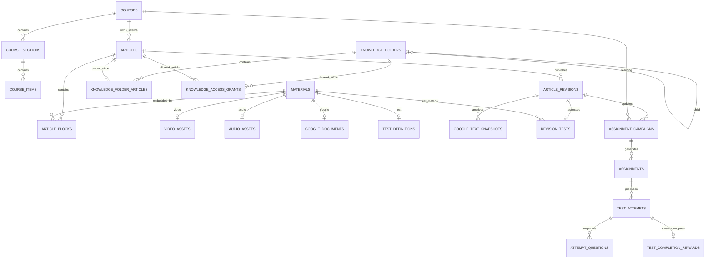

# Концептуальная ER-диаграмма MVP

> Показывает главные связи; точные колонки и ограничения описаны в `DATA_MODEL.md`. Статья — отдельная сущность, не тип `materials`.

Редакции есть только у статей Базы знаний. Курс и внутренняя статья живые; начатая попытка теста хранит технический снимок. Историческое содержимое Google Docs сохраняется компактным текстом.

<!-- Requirements traceability: REQ-163, REQ-164, REQ-165 -->
